# Automated Fluid Transfer System - Simulink Digital Twin
### LAM Research Challenge 3.0 (Stage 2)

Simulink model and ESP32 controller implementation for the Automated Chemical Distribution, Line Flush, and Sump Protection system based on P&ID Drawing PID-001.

---

## P&ID Flow Diagram

The physical system consists of a 10L process reservoir, a 4.2L flush tank, an intermediate 4.2L sump, three DC pumps, solenoid/manual valves, and an in-line turbine flow meter.

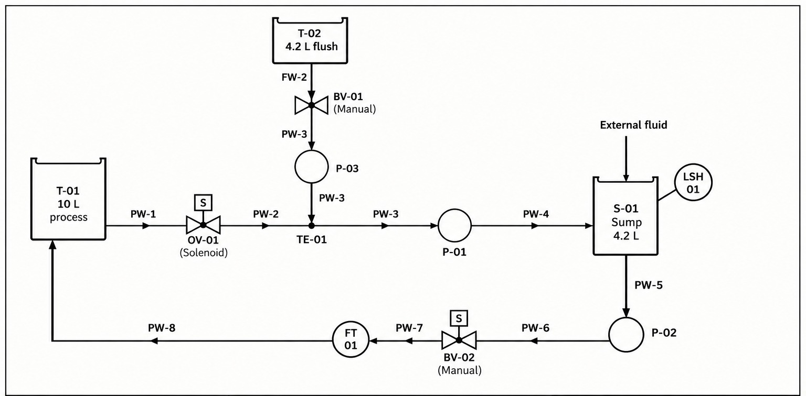

### Key Hardware:
* **T-01 (10 L)**: Main chemical feed reservoir (starts at 8 L).
* **OV-01**: Solenoid shutoff valve on feed line PW-1.
* **T-02 (4.2 L)**: Flush solvent reservoir (starts at 4.2 L).
* **BV-01 & BV-02**: Manual ball valves on flush and recirculation lines.
* **P-01**: Feed pump (delivers 3.0 L/min at 50% PWM).
* **P-02**: Recirculation pump (drains sump through FT-01 back to T-01).
* **P-03**: Flush pump (pumps flush solvent into tee junction TE-01).
* **S-01 (4.2 L)**: Collection sump with high/low float switch protection.
* **FS-01**: Float switch (trips at 3.5 L, resets at 2.5 L to prevent overflow).
* **FT-01**: Turbine flow transmitter (5266 pulses/L).

---

## Simulink Model Architecture

The top-level model (`lam_stage2_system.slx`) is split into four clean subsystems with straight signal routing:

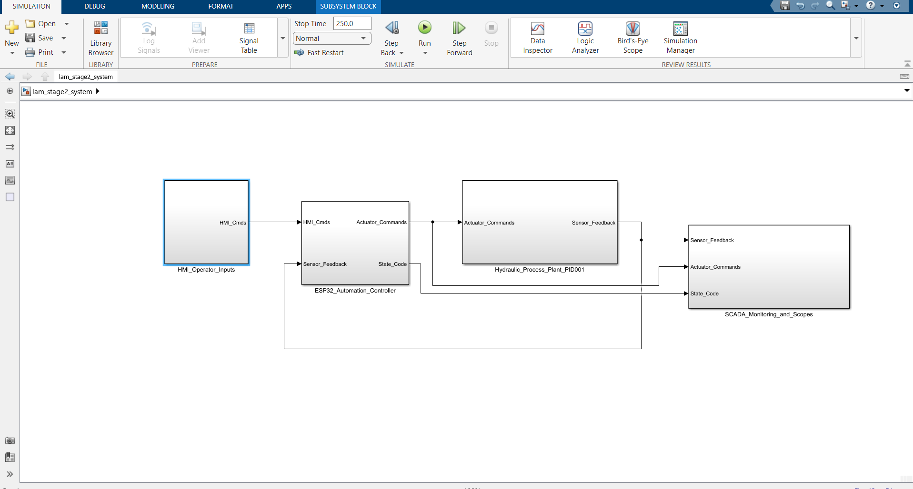

1. **HMI_Operator_Inputs**: Push button start, manual valve controls, disturbance valve, and simulation clock.
2. **ESP32_Automation_Controller**: Embedded state machine logic running the firmware control sequence.
3. **Hydraulic_Process_Plant_PID001**: Physical mass balance, pump curves, and pipe connections matching the P&ID.
4. **SCADA_Monitoring_and_Scopes**: Real-time readouts, scopes, velocity/Reynolds number calculation, and data loggers.

---

### Subsystem Breakdown

#### 1. Operator Inputs (HMI)
Handles the start push button at t = 1.0s, flush valve input, and external fluid disturbance injection (10 L/min at t = 90s for 25s) to test sump overflow protection.

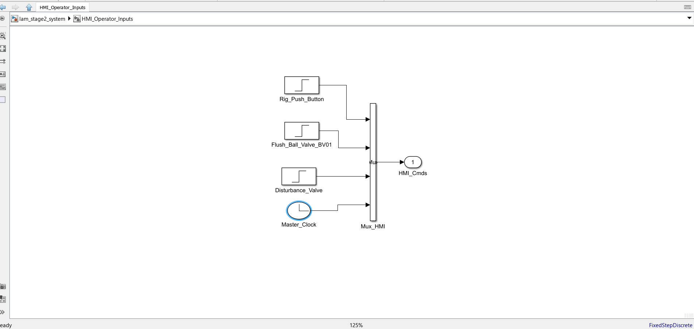

#### 2. ESP32 Automation Controller
Receives operator inputs and sensor feedback (float switch state, flow rate, total volume). It runs the 9-state finite state machine and outputs PWM duty commands for all three pumps and the OV-01 solenoid valve.

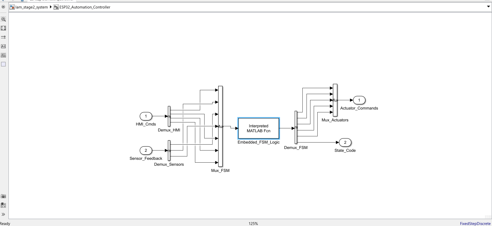

#### 3. Hydraulic Process Plant (PID-001)
Direct implementation of the piping loop:
* Flush line on top: T-02 -> BV-01 -> P-03 -> TE-01.
* Main line in middle: T-01 -> OV-01 -> TE-01 -> P-01 -> S-01.
* Return loop on bottom: S-01 drain -> P-02 -> BV-02 -> FT-01 -> return to T-01.
* Float switch on Sump S-01 triggering safety shutoff if volume exceeds 3.5 L.

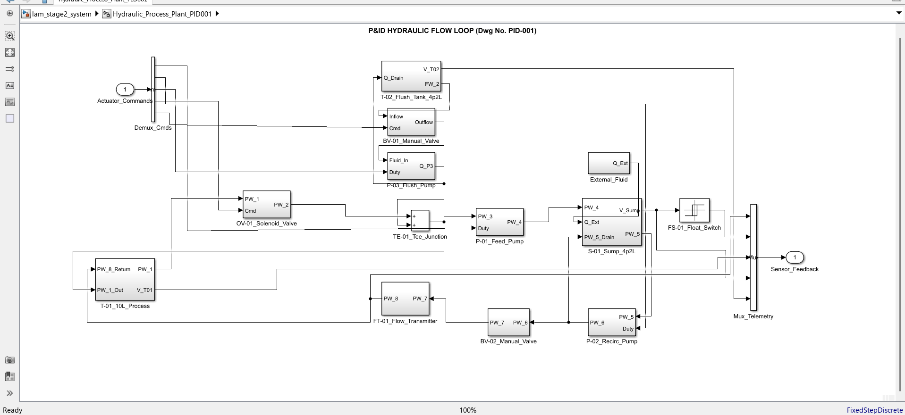

#### 4. SCADA Dashboard & Scopes
Displays real-time values for tank levels, line flow rate, total volume, active state, and Reynolds number ($Re \approx 8000$, turbulent flow). Logs all simulation runs to workspace arrays.

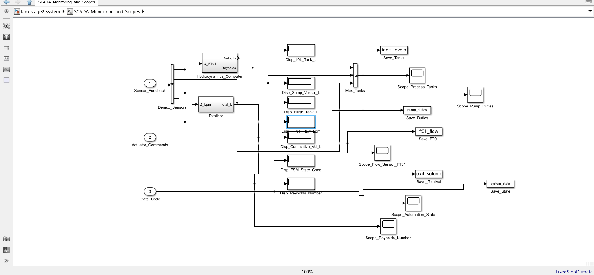

---

## Controller State Machine

The ESP32 controller executes the following sequence:

| State | Name | Description | Active Actuators |
| :---: | :--- | :--- | :--- |
| 0 | **IDLE** | Standby mode awaiting operator start button. | All OFF, OV-01 closed |
| 1 | **SUMP PRIMING** | Fills sump for 10s or until float switch activates. | OV-01 open, P1 at 50% |
| 2 | **RECIRCULATION** | P2 starts, establishing closed-loop recirculation. | OV-01 open, P1 at 50%, P2 at 100% |
| 3 | **FLOAT ALERT** | Triggered if sump level exceeds 3.5 L. P1 pauses while P2 drains sump to 2.5 L. | OV-01 open, P1 at 0%, P2 at 100% |
| 4 | **FLOW STABLE** | Flow rate steady at 3.0 +/- 0.25 L/min for 8 samples. | OV-01 open, P1 at 50%, P2 at 100% |
| 5 | **TRANSITION WARN**| 5-second warning before flush phase. | OV-01 open, P1 at 50%, P2 at 100% |
| 6 | **VALVE SETTLING** | 5-second settling delay with pumps quiet. | OV-01 closed, all pumps OFF |
| 7 | **FLUSH SEQUENCE** | P3 flushes lines from T-02. Automatic cutoff at 4.2 L. | OV-01 closed, P1/P2/P3 at 100% |
| 8 | **COMPLETE** | Safe shutdown after flush is complete. | All OFF, OV-01 closed |

---

## Simulation Results

Tested with a 1 ms fixed-step discrete solver across a 250-second operational cycle.

### Tank Volumes
T-01 supplies the process loop while S-01 maintains buffer volume between 1.7 L and 3.5 L. At t = 90s, external disturbance fluid is handled cleanly by the float switch pause-and-drain interlock. During Case 2, T-02 empties completely.

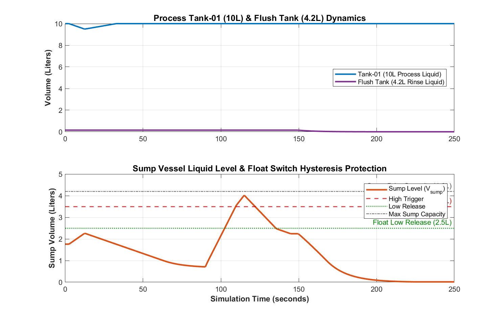

### Flow Rates
Process flow regulates cleanly at 3.0 L/min during Case 1. Recirculation flow matches through FT-01, and flush flow peaks at 5.0 L/min during Case 2.

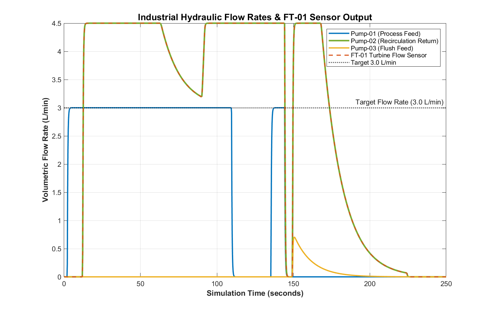

### Actuator PWM Duties & Valves
Shows the timing and duty cycles of P-01 (50%), P-02 (100%), and P-03 (100%), along with OV-01 valve opening/closing.

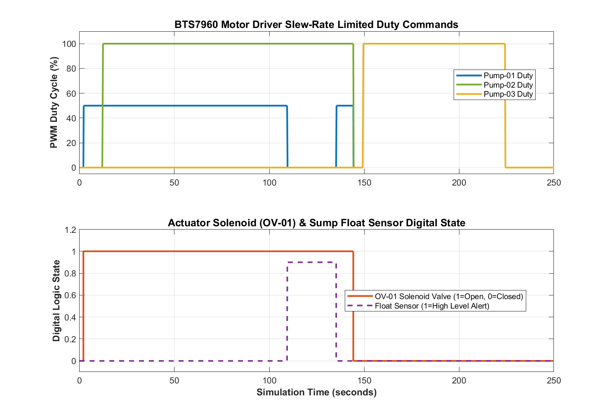

### State Transitions
Timeline showing the controller stepping through states 0 to 8 automatically.

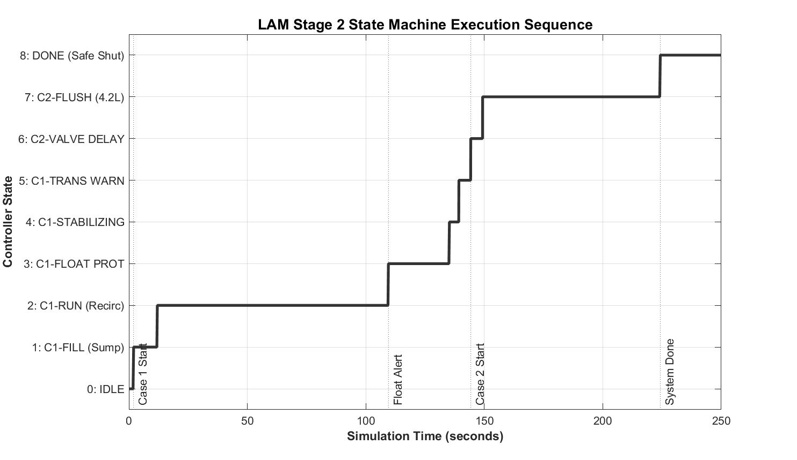

### Cumulative Volume & Flush Cutoff
FT-01 totalizer tracks fluid delivery and triggers closed-loop cutoff at 4.20 L (final volume 4.33 L including pipe hold-up).

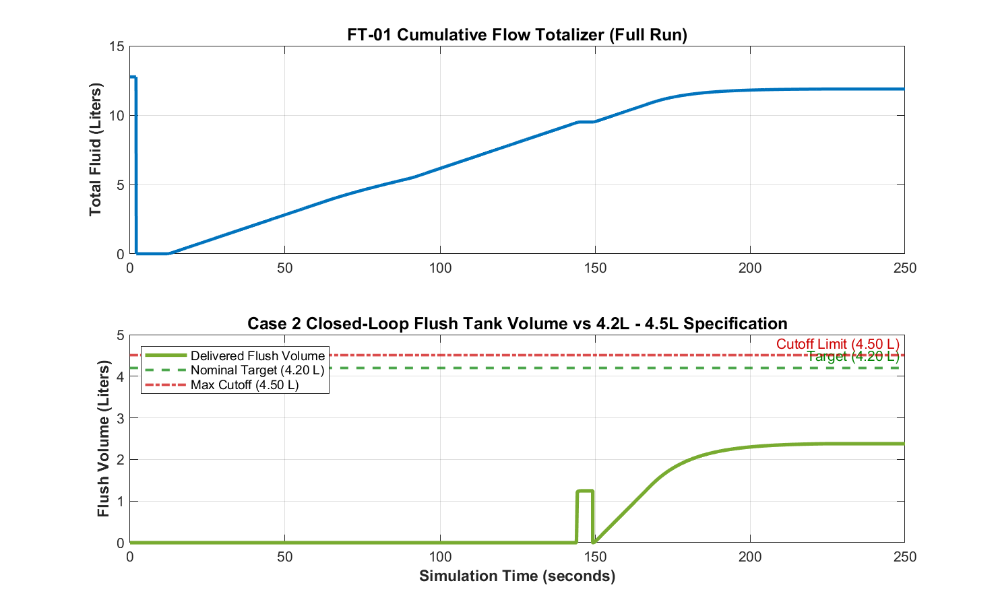

### Velocity & Reynolds Number
Pipe velocity is ~1.0 m/s in Case 1 and 1.5 m/s in Case 2. Reynolds number remains between 8,000 and 12,000, confirming turbulent flow throughout the system.

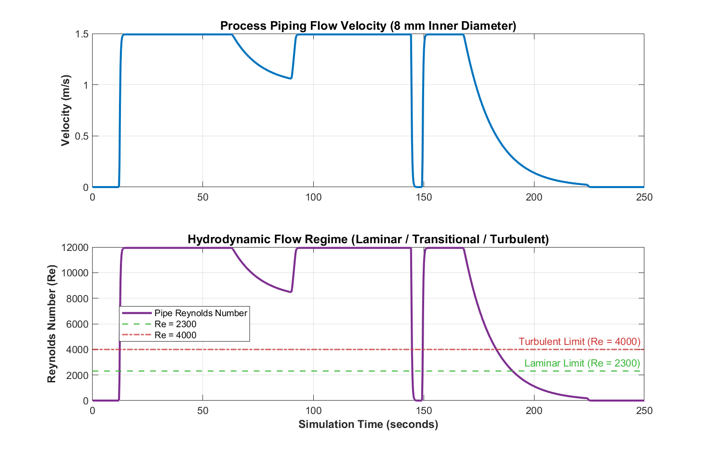

---

## How to Run

1. Open MATLAB and navigate to this folder:
   ```matlab
   cd('d:\matalb_;lam');
   ```
2. Open the model:
   ```matlab
   open_system('lam_stage2_system.slx');
   ```
3. Run the simulation and generate all verification plots:
   ```matlab
   run_lam_simulation;
   ```
